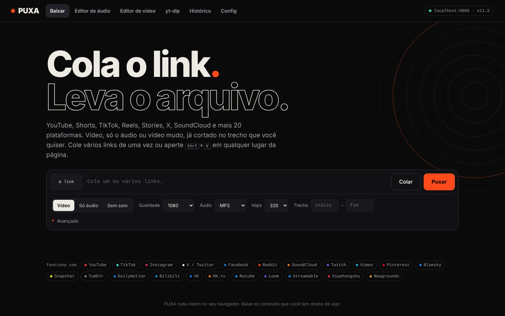
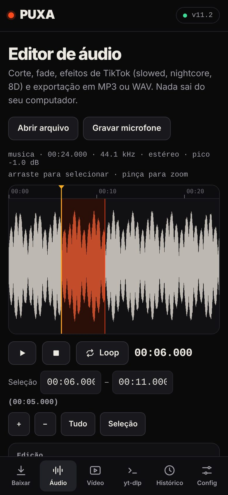

# PUXA

Baixe vídeo e áudio do YouTube, TikTok, Instagram e de mais 20 plataformas, corte o trecho que quiser e edite tudo no navegador. Quem usa não instala nada: é só abrir o link.

**Acesse:** https://voidsilva.github.io/Puxe/



<p align="center"></p>

## O que dá pra fazer

**Baixar**

- Vídeo com som, só o áudio (MP3, WAV, OGG, OPUS ou o original) ou vídeo mudo
- Qualidade de 144p até 8K (quando a fonte tem), kbps do áudio e codec do YouTube
- Cortar o trecho já no download
- Vários links de uma vez, com fila e barra de progresso
- Galeria para posts com várias fotos e vídeos (carrossel do Instagram, fotos do TikTok)
- Capas do YouTube em HD
- Histórico salvo no próprio navegador

**Editor de áudio**

- Forma de onda com zoom (roda do mouse no PC, pinça no celular)
- Cortar, apagar, silenciar, copiar e colar, fade in e out, normalizar, ±3 dB, inverter, mono e aparar silêncio
- Desfazer e refazer
- Efeitos com prévia ao vivo: slowed + reverb, sped up, nightcore, grave pesado, 8D e rádio antigo
- Exporta em MP3 (até 320 kbps) ou WAV, com atalho para toque de celular de 30 s
- Grava pelo microfone

**Editor de vídeo**

- Linha do tempo com miniaturas para marcar início e fim
- Vertical 9:16 para Reels e TikTok (cortando as laterais ou com fundo desfocado) e quadrado 1:1
- Velocidade, resolução e FPS ajustáveis, exportando em MP4 ou WebM
- Cria GIF, extrai o áudio e salva frame em PNG

**yt-dlp**

- Monta o comando pronto para playlists, canais inteiros, legendas, SponsorBlock e cookies do navegador

## Como funciona

O navegador não deixa um site baixar direto do YouTube ou do Instagram. Por isso o download passa por um servidor com o [cobalt](https://github.com/imputnet/cobalt), um projeto de código aberto que busca o arquivo e devolve para o navegador. Esse servidor fica no [Render](https://render.com) e já vem configurado no site, então o visitante não precisa instalar nada.

Todo o resto roda no aparelho de quem usa: editor de áudio, editor de vídeo, GIF, conversão para MP3 e o gerador do yt-dlp.

## Publicando o servidor (uma vez só)

Isso é só para quem mantém o site. O arquivo [`render.yaml`](render.yaml) já descreve tudo.

[](https://render.com/deploy?repo=https://github.com/voidsilva/Puxe)

1. Clique no botão acima e entre no Render com a conta do GitHub.
2. Confirme o deploy do serviço `puxe-cobalt` no plano Free.
3. Quando terminar, confira se o endereço do serviço é `https://puxe-cobalt.onrender.com`. Se o Render der outro nome, troque o `API_URL` no `render.yaml` e o `SERVIDOR_PADRAO` no `index.html`.

O que esperar do plano grátis:

- **Dorme quando ninguém usa.** Depois de 15 minutos parado, o servidor desliga e leva cerca de 1 minuto para voltar. O site já começa a acordar o servidor assim que abre e avisa o visitante enquanto isso. O plano pago mais barato não dorme.
- **YouTube pode bloquear.** O YouTube bloqueia servidores de data center. A saída é dar ao servidor os cookies de uma conta Google descartável (veja abaixo). TikTok, Instagram, X e as outras plataformas funcionam sem isso.
- **Só o site usa o servidor.** O `render.yaml` libera o servidor apenas para `voidsilva.github.io`, para outros sites não gastarem a sua cota.

Se o servidor falhar, o próprio PUXA oferece abrir o link no cobalt.tools ou gerar o comando do yt-dlp.

## YouTube pela API paga (Vercel + Apify)

O YouTube bloqueia servidores de nuvem, então os links dele não passam pelo cobalt. Eles vão para uma função na Vercel ([`api/youtube.js`](api/youtube.js)) que usa o ator [YouTube Download API](https://apify.com/johnvc/youtube-download-api) da Apify. A chave fica guardada na Vercel e nunca chega ao navegador.

1. Crie uma conta na [Apify](https://apify.com) (o plano grátis dá um crédito mensal) e copie o token em **Settings → API & Integrations**.
2. Na Vercel, projeto `puxe` → **Settings → Environment Variables**, crie `APIFY_TOKEN` com o token e faça um novo deploy.

A cobrança é por minuto de vídeo baixado. A função limita em 1080p e 60 minutos por vídeo.

## Liberando o YouTube com cookies (alternativa grátis)

1. Crie uma conta Google nova só para isso. Nunca use a sua conta pessoal: o YouTube pode bloquear a conta usada em servidor.
2. Numa janela anônima, entre nessa conta e abra o youtube.com.
3. Exporte os cookies com a extensão [Get cookies.txt LOCALLY](https://github.com/kairi003/Get-cookies.txt-LOCALLY) e feche a janela **sem sair da conta**.
4. No PUXA, abra **Config → Para o dono do servidor**, cole o arquivo e clique em **Gerar cookies.json**. A conversão roda no navegador.
5. No Render, serviço `puxe-cobalt` → **Environment**: crie o Secret File `cookies.json` com o conteúdo gerado e a variável `COOKIE_PATH` = `/etc/secrets/cookies.json`.

Os cookies expiram de tempos em tempos. Quando o YouTube voltar a bloquear, repita os passos. Mesmo com cookies, o YouTube às vezes continua bloqueando IP de data center.

## Servidor no seu computador (opcional)

Útil para desenvolver ou quando o YouTube bloquear o servidor na nuvem, já que internet de casa é bloqueada bem menos. Com o [Docker](https://www.docker.com/products/docker-desktop/) instalado:

```bash
docker run -d --name cobalt --restart unless-stopped \
  -p 9000:9000 \
  -e API_URL=http://localhost:9000/ \
  ghcr.io/imputnet/cobalt:latest
```

Depois vá em **Config** no PUXA, coloque `http://localhost:9000` no topo da lista e clique em **Testar instâncias**. Se o navegador perguntar sobre acesso à rede local, permita.

## Navegadores e uso offline

Funciona melhor no Chrome, Edge e Firefox. No Safari (iPhone incluso) também roda, mas a exportação de vídeo depende do suporte do aparelho ao MediaRecorder.

Dá para baixar o `index.html` e abrir direto do computador: os editores funcionam sem internet. Só o download de redes sociais precisa do site publicado (ou de um servidor no seu computador), e a primeira exportação em MP3 precisa de internet para carregar o codificador.

## Atalhos

| Onde            | Tecla                                 | O que faz                                 |
| --------------- | ------------------------------------- | ----------------------------------------- |
| Qualquer aba    | `Ctrl` + `V`                          | Cola o link e já começa a baixar          |
| Editor de áudio | `Espaço`                              | Toca e pausa                              |
|                 | `Del`                                 | Apaga a seleção                           |
|                 | `Ctrl` + `Z` / `Ctrl` + `Shift` + `Z` | Desfaz e refaz                            |
|                 | `Ctrl` + `A`                          | Seleciona tudo                            |
|                 | `L`                                   | Liga e desliga o loop                     |
|                 | `Esc`                                 | Limpa a seleção                           |
| Editor de vídeo | `Espaço`                              | Toca e pausa                              |
|                 | `I` / `O`                             | Marca o início e o fim                    |
|                 | `←` `→`                               | Volta e avança um quadro (`Shift`: 1 s)   |

## Por dentro

- Um arquivo só (`index.html`) com HTML, CSS e JavaScript puro. Sem framework e sem etapa de build.
- Sem fontes externas e sem animação rodando em segundo plano, para ficar leve no celular.
- Os efeitos usam a mesma cadeia da Web Audio API na prévia e na exportação (`OfflineAudioContext`).
- WAV e GIF são codificados no próprio código. O MP3 usa o [lamejs](https://github.com/zhuker/lamejs), carregado só quando alguém exporta em MP3.
- O vídeo é exportado com Canvas e `MediaRecorder`, em tempo real.
- Configurações e histórico ficam no `localStorage` do navegador.

## Aviso

Baixe só conteúdo que você tem direito de usar. O PUXA não hospeda nem guarda nenhum arquivo.
